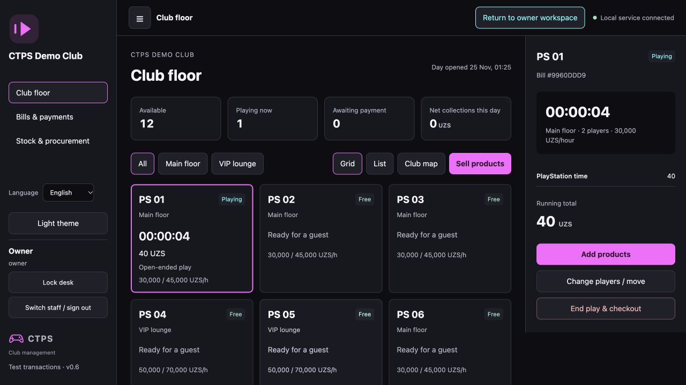
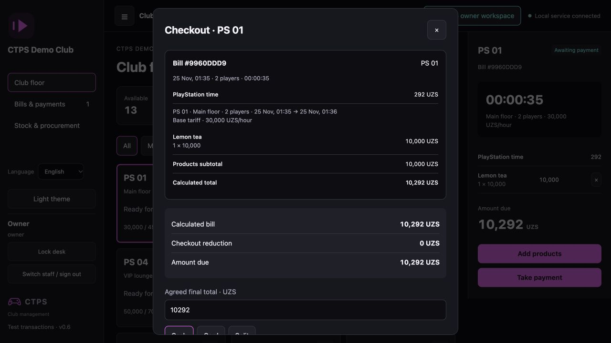
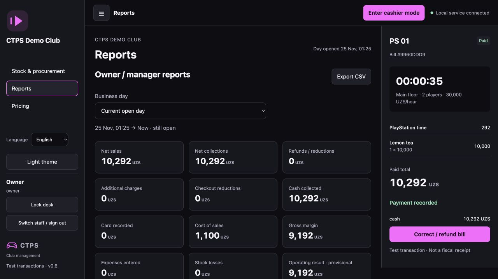
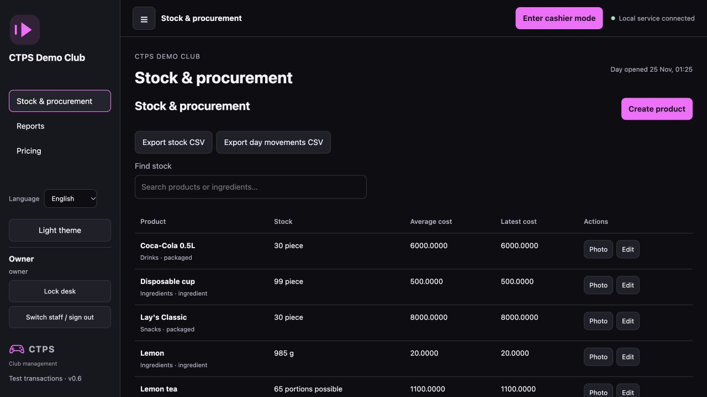

# CTPS · Gaming club operations

**See which stations are free, charge for play and purchases, and reconcile the shift.**

**Club floor.** The cashier can see which stations are available, occupied, or under maintenance. The selected station shows elapsed time, the hourly rate, and the running bill.

## From play to payment

The cashier ends the session and sees one itemized bill for play time and products. In this walkthrough, PS 01 and one lemon tea came to **10,292 UZS** in the sample register.

## The same sale in the owner’s report

The owner sees the **10,292 UZS** test payment in the current business day and can trace it back to the paid bill. The report also shows cost of sales and gross margin.

## Stock and ingredients

The stock screen shows packaged products, ingredients, and how many portions can be prepared from the available stock.

---

All four screenshots come from the same local alpha demo with a fictional club and sample transactions. No real payment was processed.
